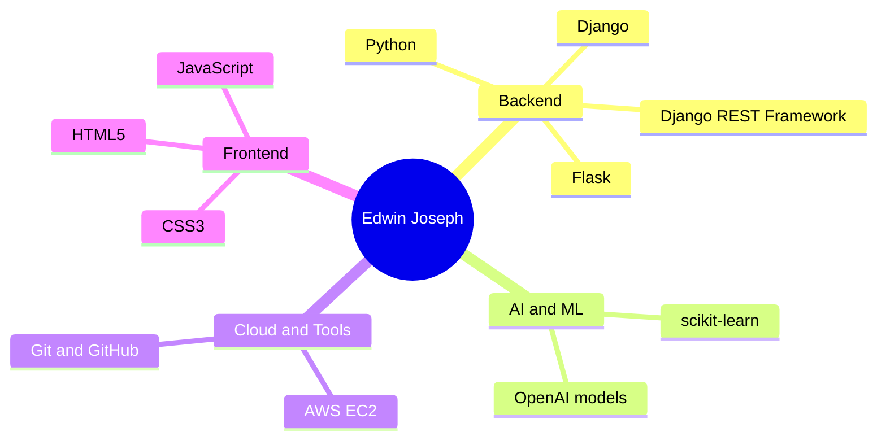

 

  

---

## ⚡ At a Glance

| | |
|:--|:--|
| 🎯 **Role** | Full-Stack / Backend Developer |
| 🎓 **Education** | MCA student |
| 📍 **Location** | Alappuzha, Kerala, India |
| 🧰 **Core stack** | Python · Django · REST APIs · Flask · scikit-learn |
| ☁️ **Deployment** | AWS EC2 |
| 🤝 **Looking for** | Internships and entry-level developer roles |

---

## 👋 About Me

I'm a Full-Stack Developer and MCA student who enjoys turning real-world problems into practical web applications and AI-powered solutions.

During my internship I contributed to an **AI-powered production application**, working with **Python, Django REST APIs and OpenAI models**. I enjoy backend development, applied machine learning, and shipping features that people actually use.

I'm always learning, always building, and looking for a development team where I can contribute and grow.

---

## 🧭 Skill Map

---

## 🚀 Featured Projects

<table>
<tr>
<td width="33%" valign="top">

### 🌊 FloodWatch Kerala
Flood early-warning, community reporting and shelter management portal for Kerala, **deployed on AWS EC2**.

[Code](https://github.com/edwj21-blip/floodwatch-kerala) · [Live demo](http://3.27.156.156:8000/login/?next=/flood-map/)

</td>
<td width="33%" valign="top">

### 🌧️ RainCast
Rainfall prediction web app powered by a **machine learning model**.

[Code](https://github.com/edwj21-blip/raincast-rainfall-prediction)

</td>
<td width="33%" valign="top">

### 🧑‍💻 Portfolio
My personal portfolio website, live on Vercel.

[Code](https://github.com/edwj21-blip/portfolio) · [Live](https://edwin-03-portfolio.vercel.app/)

</td>
</tr>
<tr>
<td colspan="3" valign="top">

### 🤖 JARVIS Phone Control Center (in progress)
Personal AI desktop agent that controls an Android phone over ADB, with screen mirroring, a safe file manager, WhatsApp assistance and voice commands. Runs fully locally and never bypasses the lock screen.

🔒 Private repository while in development

</td>
</tr>
</table>

---

## 🛠️ Tech Stack

**Languages**

**Backend & APIs**

**AI & Machine Learning**

**Cloud & Tools**

---

## 💼 Experience

<b>🤖 Software Developer Intern · AI-powered production application</b>

 

- Contributed to a **production AI application** used in the real world
- Built and worked with **Django REST APIs** in Python
- Integrated **OpenAI models** into application features
- Collaborated with a development team on live features

---

## 🎯 Why Work With Me

| 🧠 Backend focus | 🤖 Applied AI | ☁️ Ships to the cloud |
|:--|:--|:--|
| Django apps and REST APIs | OpenAI integration and ML prediction | Live deployment on AWS EC2 |

---

## 📊 GitHub Streak

---

### 📫 Let's build something together

Open to **internships and entry-level roles** in Python, Django and backend development.

[Portfolio](https://edwin-03-portfolio.vercel.app/) · [LinkedIn](https://www.linkedin.com/in/edwin-joseph-977b0043b) · [Email](mailto:edwj21@gmail.com)

